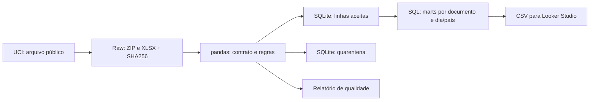

# Retail Data Pipeline

Pipeline de Engenharia de Dados para analisar vendas e créditos de um varejista online: **Python → pandas → SQLite → Looker Studio**.

O projeto responde a três perguntas: como o valor das vendas varia no tempo, quais países concentram a movimentação e quanto os créditos reduzem o valor vendido. A implementação mantém a origem de cada linha e concilia os valores antes de exportar dados para BI.

**Status:** pipeline implementado; resultados da execução em `docs/quality_report.json`. O relatório Looker Studio ainda precisa ser montado e publicado. Não há link de dashboard publicado neste estágio.

## Execução de referência

| Verificação | Resultado |
| --- | ---: |
| Linhas na fonte | 541.909 |
| Linhas aceitas | 539.392 |
| Linhas em quarentena | 2.517 |
| Documentos no mart | 23.796 |
| Possíveis duplicatas preservadas | 5.268 |
| Linhas aceitas sem cliente identificado | 132.603 |

As 2.517 linhas rejeitadas têm preço nulo ou não positivo. Os valores aceitos totalizam **GBP 10.666.684,544 em vendas brutas**, **GBP 896.812,490 em créditos** e **GBP 9.769.872,054 em movimentação líquida**. Três casas são exibidas aqui para preservar a precisão da fonte; no dashboard, usar duas casas para apresentação.

## Arquitetura



## Executar

Python 3.11+; a execução local foi realizada com Python 3.14. A primeira execução baixa aproximadamente 23 MB. Não exige chave de API nem conta Kaggle.

```bash
python -m venv .venv
# Windows PowerShell
.venv\Scripts\Activate.ps1
# Linux/macOS: source .venv/bin/activate
python -m pip install -r requirements.txt
python -m unittest discover -s tests -v
python pipeline.py
```

`python pipeline.py --refresh` baixa novamente a fonte. `--data-root CAMINHO` muda o destino dos dados. `requirements-lock.txt` registra as versões usadas na execução de referência.

## Entregas

| Arquivo | Finalidade |
| --- | --- |
| `data/warehouse/retail.sqlite` | Banco com fato, quarentena e views SQL |
| `data/processed/mart_invoice.csv` | Uma linha por documento; fonte recomendada para o BI |
| `data/processed/mart_daily_country.csv` | Agregado diário por país; sem identificadores de clientes |
| `data/processed/quality_report.json` | Contagens, conciliação, período e hash da fonte |

Os arquivos são gerados localmente e ignorados pelo Git. O workflow manual do GitHub Actions permite reproduzir a extração e baixar os CSVs como artefato. Os testes rodam em push e pull request, sem depender da disponibilidade da UCI.

## Decisões de engenharia

- **Carga completa idempotente:** reexecutar substitui o banco, sem acumular linhas. O banco é construído em arquivo temporário e substituído após validação. As exportações CSV são locais e devem ser consumidas somente após a conclusão bem-sucedida do processo; não há publicação transacional conjunta dos arquivos.
- **Precisão monetária:** valores em milésimos inteiros de libra no banco, preservando preços com três casas. O BI recebe libras. Não há conversão cambial.
- **Sem exclusão cega de duplicatas:** linhas repetidas podem representar itens legítimos; a fonte não traz chave de item. Elas são contadas, preservadas e identificáveis pela linha original.
- **Créditos separados de vendas:** quantidade negativa com preço positivo é crédito/ajuste. Não se presume que cada crédito seja uma devolução física ou que exista vínculo com a venda original.
- **Clientes ausentes:** ficam nulos e não eliminam vendas válidas. Contagem de clientes identificados não representa todos os compradores.
- **Escopo local:** SQLite permite executar sem infraestrutura. Este projeto não implementa CDC, orquestrador distribuído, SLA nem conexão automática do Looker ao SQLite. O consumo no Looker usa exportação CSV.

## Documentação

- [Contrato e dicionário](docs/data-dictionary.md)
- [Regras de negócio e limitações](docs/business-rules.md)
- [Montagem e publicação no Looker Studio](docs/looker-studio.md)
- [Roteiro para explicar o projeto](docs/interview.md)

## Fonte e licença

Chen, D. (2015). **Online Retail**. UCI Machine Learning Repository. DOI: https://doi.org/10.24432/C5BW33.

Fonte: https://archive.ics.uci.edu/dataset/352/online+retail. Transações de 01/12/2010 a 09/12/2011, valores em GBP; base histórica, sem atualização de vendas atuais. Dados sob **CC BY 4.0**, com atribuição à fonte. Código sob MIT, conforme `LICENSE`.
